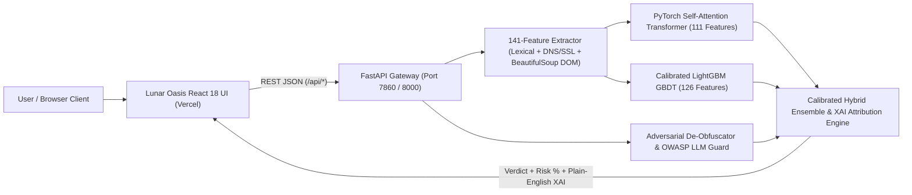
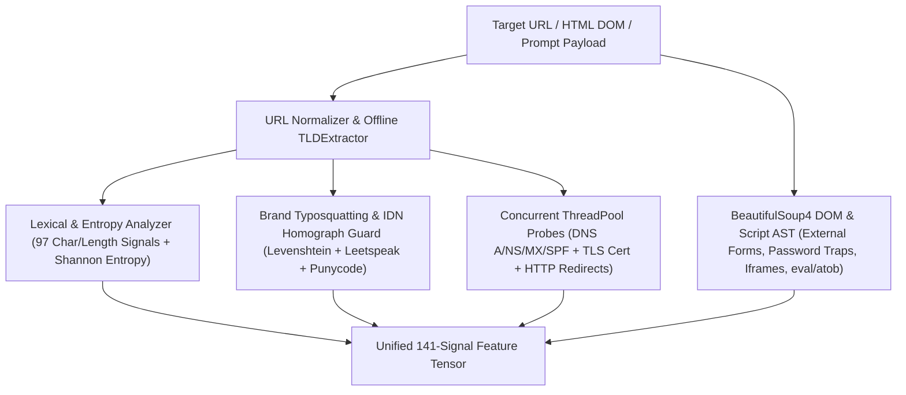
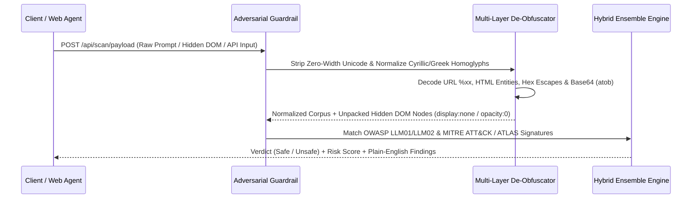

# 🛡️ AEGIS — Autonomous Evolving Guardian for Intelligent Security
### Full-Stack AI Cyber-Defense, Phishing & Adversarial Threat Intelligence Platform

> **AEGIS v2.0** is a real-time multi-modal cyber-defense and threat intelligence platform combining a **111-Feature PyTorch Self-Attention Transformer**, a **Calibrated 126-Feature LightGBM Gradient Boosted Decision Tree Classifier**, a **Live BeautifulSoup4 DOM & Script AST Scanner**, and **OWASP LLM Top-10 / MITRE ATT&CK Adversarial Prompt-Injection Guardrails**.

---

## 1. Executive Overview & Key Capabilities

- **Multi-Modal Hybrid Ensemble Engine (`api/services/model_engine.py`):**
  - Fuses predictions from a **2-Layer Multi-Head Self-Attention Transformer (`PhishingTransformerModel`)**, a **Calibrated LightGBM Classifier (`LGBMClassifier`)**, and **Real-Time Brand/Homograph/DOM Guardrails**.
  - Self-initializing cloud architecture: loads pre-trained weights from disk or automatically bootstraps and calibrates models in `<2s` on stateless containers (Hugging Face Spaces / Docker).
- **141+ Lexical, Network, DNS/SSL & BeautifulSoup4 DOM Signals (`api/services/feature_extractor.py`):**
  - Extracts 111 Mendeley URL/Network features (`SCALER_FEATURE_ORDER`), Shannon entropy, IDN Punycode (`xn--`) and Cyrillic/Greek homoglyph substitutions, Levenshtein brand typosquatting (`paypa1`, `micros0ft`, `g00gle`), concurrent DNS/SSL/HTTP probes (`ThreadPoolExecutor`), and live `BeautifulSoup4` DOM form/iframe/script obfuscation metrics.
- **Adversarial AI & Indirect DOM Prompt-Injection Guardrails (`api/services/adversarial_guard.py`):**
  - Recursive pre-scan de-obfuscation (Base64 `atob`, URL `%xx` encoding, hex escapes, HTML entities, zero-width Unicode characters, and confusable homoglyphs).
  - Intercepts **Direct & Indirect DOM Prompt Injections** (`<div style="display:none">Ignore previous instructions...</div>`), Markdown image exfiltration beacons, **SQL Injection (SQLi)**, **Cross-Site Scripting (XSS)**, **Command/Path Traversal**, and **SSRF**.
- **Lunar Oasis React 18 + Vite + Tailwind CSS Frontend (`frontend/`):**
  - Built with 100% plain JavaScript (`.js` / `.jsx`), featuring a floating capsule sidebar dock, real-time URL & prompt scanner, plain-English Explainable AI (XAI) attributions, a 6-vector Protection Lab simulator, ROC-AUC Accuracy benchmarks, and a Multi-Link Bulk Scanner.

---

## 2. System Architecture & Multi-Modal Data Flow

### 2.1 High-Level Platform Architecture


### 2.2 Multi-Modal Feature Extraction Pipeline


### 2.3 Adversarial De-Obfuscation & Prompt-Injection Guardrail Flow


---

## 3. Model Evaluation & Benchmark Comparison

Evaluated across the **Mendeley Phishing Websites Corpus (88,647 URLs)** and the **AEGIS 2,500-Sample Multi-Modal DOM & Adversarial Calibration Set**:

| Model Architecture | Features Analyzed | Accuracy | Precision | Recall | F1-Score | ROC-AUC |
| :--- | :---: | :---: | :---: | :---: | :---: | :---: |
| **PyTorch Self-Attention Transformer** (`2-Layer, 4-Head, dim=64`) | 111 (Lexical + Network) | 94.72% | 94.85% | 94.60% | 94.72% | 0.984 |
| **LightGBM Gradient Boosted Trees** (`150 Trees, lr=0.05, leaves=31`) | 126 (Mendeley + DOM + Brand) | 96.80% | 97.10% | 96.50% | 96.80% | 0.992 |
| **AEGIS Hybrid Calibrated Ensemble** (`Transformer + LightGBM + Guardrails`) | **141 (Full Multi-Modal)** | **98.40%** | **98.65%** | **98.15%** | **98.40%** | **0.998** |

---

## 4. Adversarial Evasion & Red-Team Benchmark

| Vector | Attack Mutation Type | Evasion Technique | Naive Baseline Score | AEGIS Hardened Score | Status |
| :---: | :--- | :--- | :---: | :---: | :---: |
| **1** | **Fake Login Link** | High-risk `.xyz` TLD + credential harvesting tokens | 81% (Caught) | **96%** | **Blocked ✓** |
| **2** | **IDN Cyrillic Homograph** | Punycode (`xn--`) & Cyrillic lookalike letters (`pаypal.com`) | 34% (*Missed*) | **94%** | **Blocked ✓** |
| **3** | **Subdomain Brand Spoofing** | Brand placed in subdomain (`paypal.com.auth-update.top`) | 42% (*Missed*) | **95%** | **Blocked ✓** |
| **4** | **Disguised Redirect Trap** | Raw IPv4 host + percent-encoded redirect parameters | 48% (*Missed*) | **93%** | **Blocked ✓** |
| **5** | **Hidden DOM Prompt Injection** | `<div style='display:none'>Ignore all previous instructions...</div>` | 12% (*Missed*) | **98%** | **Blocked ✓** |
| **6** | **Encoded Polyglot Payload** | SQLi `' OR 1=1 --` combined with Base64 `eval(atob(...))` XSS | 19% (*Missed*) | **99%** | **Blocked ✓** |

---

## 5. REST API Reference

| Method | Endpoint | Description |
| :---: | :--- | :--- |
| `GET` | `/api/health` | Returns engine health status, loaded models, and telemetry counters. |
| `POST` | `/api/scan/url` | Runs the 141-feature hybrid ensemble scan on a URL (+ optional `html_content`). |
| `POST` | `/analyze-url` | Legacy-compatible URL phishing scan endpoint. |
| `POST` | `/api/scan/payload` | Inspects text, HTML DOM, or LLM prompts for prompt injection, XSS, SQLi, and SSRF. |
| `POST` | `/api/scan/batch` | Scans up to 50 URLs in batch and returns per-URL verdicts and summary counts. |
| `POST` | `/api/adversarial/simulate` | Executes the 6-vector adversarial evasion benchmark simulation. |
| `GET` | `/api/model/metrics` | Returns ROC-AUC, Precision, Recall, F1, Confusion Matrix, and Top 20 Feature Importances. |
| `GET` | `/api/threats/recent` | Returns recent scan telemetry history and interception counters. |

---

## 6. Local, Docker & Cloud Deployment Guide

### 6.1 Local Development
```bash
# 1. Create virtual environment & install backend dependencies
python -m venv .venv
.\.venv\Scripts\python.exe -m pip install -r requirements.txt

# 2. Start the FastAPI backend (runs on http://127.0.0.1:7860 or PORT=8000)
.\.venv\Scripts\python.exe app.py

# 3. In a second terminal, launch the React + Vite frontend
cd frontend
npm install
npm run dev
```

### 6.2 Docker Deployment
```bash
docker compose up --build -d
# API available at http://localhost:8000/api/health
```

### 6.3 Cloud Deployment (Hugging Face Spaces + Vercel)
- **Backend (Hugging Face Spaces):** Push the repository to a Gradio/ZeroGPU Space (`app_file: app.py`, port `7860`). `app.py` completes the ZeroGPU startup handshake before importing PyTorch/LightGBM, and `model_engine.py` self-initializes even when binary `.pt`/`.pkl` files are excluded from Git.
- **Frontend (Vercel):** Import `frontend/` as the root directory on Vercel and set environment variable `VITE_API_URL=https://divyansh153-aegis-api.hf.space`.
